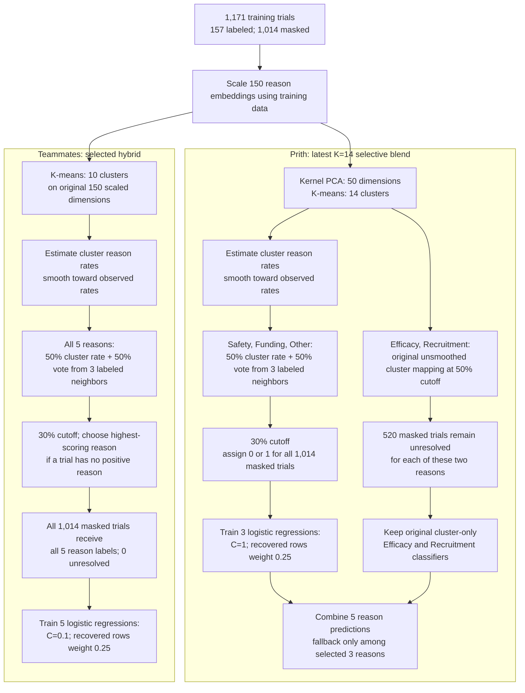

# Part 1 labeling: Prith and teammates

Both approaches start with **1,171 training trials**: 157 have observed labels for five possible stopping reasons, and 1,014 have all five labels hidden. Both fit preprocessing on training data and use the original 150 scaled embeddings for their final classifiers.

The neighbor votes in both paths come only from the **157 originally labeled trials**. “Unresolved” means a recovered training label was left missing; it does not mean a final test prediction was left blank.

| Model | Validation sample F1 | Validation macro F1 | Safety | Funding | Efficacy | Recruitment | Other | Kaggle public sample F1 |
|---|---:|---:|---:|---:|---:|---:|---:|---:|
| Prith K=14 selective blend | **0.9103** | **0.7925** | 0.7059 | 0.6667 | **0.9333** | **0.9899** | **0.6667** | Not submitted |
| Prith K=21 selective blend | 0.8932 | 0.7752 | 0.7059 | 0.6667 | 0.8667 | 0.9703 | **0.6667** | 0.84508 (user reported) |
| Teammates K=10 hybrid | 0.8868 | 0.7792 | **0.8889** | 0.6667 | 0.8000 | 0.9524 | 0.5882 | 0.87927 (recorded in team notes) |

The K=14 variant is Prith's latest validation result; the K=21 variant is their strongest **submitted** result. The public scores compare different submitted configurations and do not identify which pipeline difference caused the gap. The validation set has only 78 trials, so small changes are uncertain.

Sources: [Prith's experiment log](EXPERIMENT_LOG.md), [K-means experiment notebook](Part1_KMeans_Experiments.ipynb), [team Part 1 notes](../../PART1_NOTES.md), [teammates' selected configuration](../../part1-results/knn-experiment/best_augmented_candidate.json), and [teammates' validation predictions](../../part1-results/knn-experiment/validation_kmeans_knn_hybrid_k3_uniform.csv).
